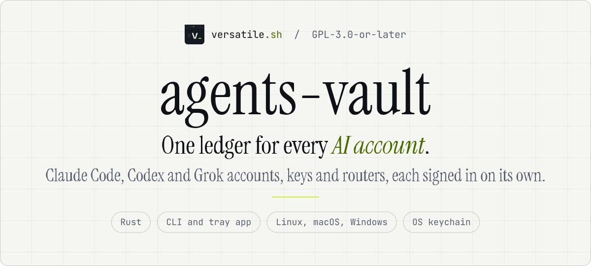
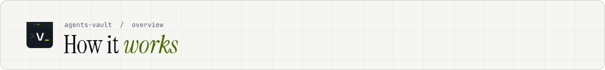
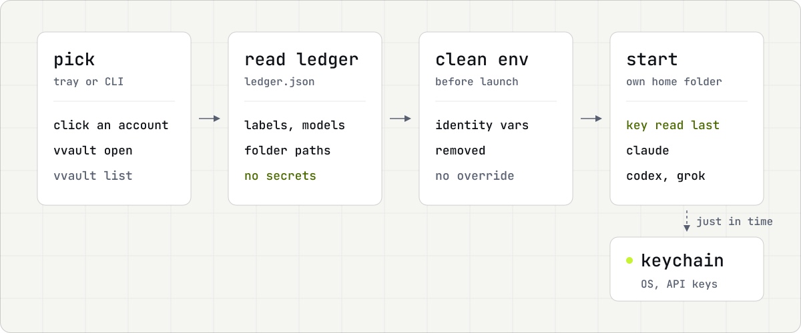

<p align="center">
  <picture>
    <source media="(prefers-color-scheme: dark)" srcset="docs/assets/banner-hero-dark.svg">
    
  </picture>
</p>

<p align="center">
  
  
</p>

<p align="center">
  <b><a href="#install">Install</a></b> &nbsp;·&nbsp;
  <b><a href="#usage">Usage</a></b> &nbsp;·&nbsp;
  <a href="#how-it-works">How it works</a> &nbsp;·&nbsp;
  <a href="docs/safety.md">How it stays safe</a>
</p>

Versatile Vault keeps one ledger for every Claude Code, Codex and Grok account, API key and router. Click an account and a terminal opens already signed in, on the right model, with your shared instructions in place. A tray icon shows each account's 5-hour and weekly limits.

<a id="what-it-is"></a>

<picture>
  <source media="(prefers-color-scheme: dark)" srcset="docs/assets/section-what-it-is-dark.svg">
  
</picture>

It runs on your own machine (Linux, macOS and Windows) as a Rust workspace: a core library, the `vvault` command and a Tauri tray app. Every account has its own home folder, so credentials are never copied between folders. Versatile Vault never stores, copies or refreshes an OAuth token: sign-in, refresh and sign-out are done by `claude`, `codex` and `grok` themselves. Not affiliated with Anthropic, OpenAI or xAI.

| For | You get | Start with |
|---|---|---|
| **People with several AI accounts** | one click per account, limits at a glance, one default account per machine | [Usage](#usage) |
| **People using other providers** | provider keys in the OS keychain, opened in the tool you use | [Using vvault](docs/usage.md) |

<a id="documentation"></a>

<picture>
  <source media="(prefers-color-scheme: dark)" srcset="docs/assets/section-documentation-dark.svg">
  
</picture>

[Using vvault](docs/usage.md) covers the default account, provider keys, shared instructions, limits, models, keep-alive and bars. [How it stays safe](docs/safety.md) lists the rules. Engineering documentation is kept by Versatile outside this repository.

<a id="how-it-works"></a>

<picture>
  <source media="(prefers-color-scheme: dark)" srcset="docs/assets/section-how-dark.svg">
  
</picture>

<picture>
  <source media="(prefers-color-scheme: dark)" srcset="docs/assets/diagram-open-dark.svg">
  
</picture>

1. You pick an account in the tray app or run `vvault open <account>`.
2. vvault reads the ledger (labels, models and folder paths) and removes variables that would override the identity.
3. For an API key, it reads the key from the OS keychain at that moment and passes it through the environment only.
4. It starts the harness with that account's own home folder.

<a id="install"></a>

<picture>
  <source media="(prefers-color-scheme: dark)" srcset="docs/assets/section-install-dark.svg">
  
</picture>

You need Rust 1.89 or later and, for the tray app, the [Tauri 2 system dependencies](https://tauri.app/start/prerequisites/).

```sh
git clone https://github.com/versatile-sh/agents-vault
cd agents-vault
cargo install --path crates/cli
cargo build --release -p vvault-app --features custom-protocol
```

Put `vvault-app` next to `vvault`, or keep `vvault` on `PATH`. For installers (`.dmg`, `.msi`, `.deb`, `.AppImage`), run `cargo tauri build` inside `app/src-tauri`. With a fresh ledger, `vvault list` answers:

```text
No accounts yet. Try `vvault add work` or `vvault adopt personal`.
```

<a id="usage"></a>

<picture>
  <source media="(prefers-color-scheme: dark)" srcset="docs/assets/section-use-dark.svg">
  
</picture>

In the app, signing in opens the official page in your browser and finishes by itself. From the command line:

```sh
vvault add work                       # runs the official Claude Code sign-in
vvault add team --harness codex       # runs the official Codex sign-in
vvault add x --harness grok           # runs the official Grok sign-in
vvault adopt personal                 # track your existing ~/.claude in place

vvault list                           # accounts, limits and session state
vvault open work                      # new terminal window on that account
vvault run work -- --resume           # same, in the current terminal
vvault default work                   # plain `claude` now means the work account
```

More: [Using vvault](docs/usage.md).

<a id="configuration"></a>

<picture>
  <source media="(prefers-color-scheme: dark)" srcset="docs/assets/section-configuration-dark.svg">
  
</picture>

| Variable | Default | What it does |
|---|---|---|
| `VVAULT_HOME` | the platform's data folder | moves the ledger, which keeps experiments away from your real accounts |

<a id="development-and-tests"></a>

<picture>
  <source media="(prefers-color-scheme: dark)" srcset="docs/assets/section-development-and-tests-dark.svg">
  
</picture>

```sh
cargo test --workspace
cargo clippy --workspace --all-targets
VVAULT_HOME=/tmp/vvault-dev cargo run -p vvault -- list
```

| Path | Purpose |
|---|---|
| `crates/core` | ledger, launcher, keychain, limits, keep-alive |
| `crates/cli` | the `vvault` command |
| `app/src-tauri` | tray app backend |
| `app/ui` | tray app interface (plain HTML, CSS and JS, no build step) |

<a id="security"></a>

<picture>
  <source media="(prefers-color-scheme: dark)" srcset="docs/assets/section-security-dark.svg">
  
</picture>

API keys live in the OS keychain, never in the ledger, a config file or a command line. To report a vulnerability, contact Versatile at [versatile.sh/contact](https://versatile.sh/contact). The rules are in [How it stays safe](docs/safety.md).

<a id="contributing"></a>

<picture>
  <source media="(prefers-color-scheme: dark)" srcset="docs/assets/section-contributing-dark.svg">
  
</picture>

See [CONTRIBUTING.md](CONTRIBUTING.md); contributions are accepted under the CLA.

<a id="license"></a>

<picture>
  <source media="(prefers-color-scheme: dark)" srcset="docs/assets/section-license-dark.svg">
  
</picture>

Copyright (C) 2026 Versatile (versatile.sh)

agents-vault is free software: you can redistribute it and/or modify it under the terms of the GNU General Public License as published by the Free Software Foundation, either version 3 of the License, or (at your option) any later version. See [LICENSE](LICENSE). Third-party components keep their own licences, see [NOTICE](NOTICE).

For a commercial licence without the GPL's obligations, contact Versatile through [versatile.sh/contact](https://versatile.sh/contact).

Contributions are accepted under the CLA, see [CONTRIBUTING.md](CONTRIBUTING.md).

Versions published before this change were released under the MIT License; copies already received keep those terms.
